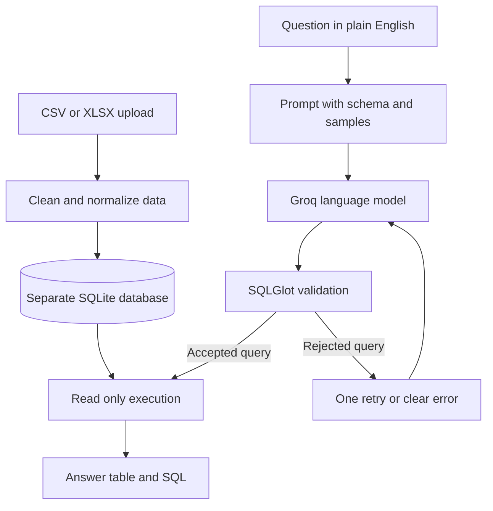

# AskData

### Ask questions about spreadsheet data in plain English.


AskData is a natural language analytics application for CSV and Excel files. A user uploads one spreadsheet and asks a question in plain English. The application generates SQL, validates it, runs it against a separate SQLite database, and displays the answer with the exact SQL that ran.

The language model only proposes SQL. Application code decides whether the SQL is safe to execute.

## Features

- Upload CSV files and Excel workbooks.
- Ask questions using plain English.
- View answers as tables.
- Inspect the exact SQL used for each answer.
- Clean column names and normalize date columns.
- Store each upload in a separate SQLite database.
- Parse generated SQL with SQLGlot before execution.
- Allow only one `SELECT` or `UNION` statement.
- Restrict queries to the uploaded table and query defined CTEs.
- Run queries through a read only database connection.
- Stop slow queries and limit large results.
- Mask common emails, phone numbers, SSNs, and long numbers in prompt samples.
- Retry once when generated SQL is invalid or fails to run.
- Test model behavior with answerable and adversarial questions.

## Architecture



## How it works

1. The user uploads a CSV or XLSX file.
2. pandas reads the file and cleans the column names.
3. AskData creates a separate SQLite database for the upload.
4. The prompt includes the table name, column names, data types, selected example values, and up to three masked sample rows.
5. The Groq model creates one SQL query and a short explanation.
6. SQLGlot parses the query into a syntax tree.
7. The validator checks the statement type, table references, and restricted functions.
8. AskData rebuilds SQL from the validated syntax tree and removes comments.
9. SQLite runs the query through a read only connection.
10. Streamlit displays the answer, explanation, and exact SQL.

The model receives schema information, selected example values, and up to three sample rows. Rows beyond this sample are not included in the prompt.

## Safety controls

| Risk | Control |
|---|---|
| A write or schema change is generated | Only a parsed `SELECT` or `UNION` is accepted |
| More than one statement is generated | Exactly one parsed statement is required |
| Another table is referenced | Only the uploaded table and local CTE names are allowed |
| Comments contain hidden instructions | SQL is rebuilt from the checked syntax tree without comments |
| A write passes validation | SQLite opens the database in read only mode |
| A query runs for too long | A progress handler stops it after the configured limit |
| A query returns too many rows | The result is limited before display |
| Uploads use the same database | Each upload receives a separate SQLite file |
| Prompt samples contain common identifiers | Basic patterns mask several common identifier formats |

## Technology stack

| Area | Technology | Purpose |
|---|---|---|
| Interface | Streamlit | File upload, question input, and results |
| Data processing | pandas and openpyxl | CSV and Excel loading |
| Database | SQLite | Local data storage and SQL execution |
| SQL validation | SQLGlot | SQL parsing and validation |
| Model access | OpenAI Python SDK | Requests to the Groq chat endpoint |
| Configuration | python dotenv | Local environment settings |
| Testing | pytest | Automated tests |

## Project structure

```text
AskData/
├── app.py                         Streamlit interface
├── askdata/
│   ├── config.py                  Application settings
│   ├── data_loader.py             CSV and Excel loading
│   ├── database.py                SQLite storage and query execution
│   ├── exceptions.py              Application error types
│   ├── llm_client.py              Model client interface
│   ├── prompt_builder.py          Prompt creation and reply parsing
│   ├── query_service.py           Question processing workflow
│   └── sql_validator.py           SQL safety checks
├── evaluation/
│   ├── evaluate.py                Evaluation runner
│   ├── questions.json             Evaluation questions
│   └── sample_sales.csv           Example dataset
├── tests/                         Automated test suite
├── .streamlit/config.toml         Streamlit configuration
├── .env.example                   Environment template
├── pytest.ini                     pytest configuration
└── requirements.txt               Python dependencies
```

## Requirements

- Python 3.10 or newer
- A Groq account and API key

## Setup on Windows Command Prompt

Run these commands from the project folder:

```cmd
py -3.11 -m venv .venv
.venv\Scripts\activate
python -m pip install --upgrade pip
python -m pip install -r requirements.txt
copy .env.example .env
notepad .env
```

Add the Groq API key to `.env`:

```env
LLM_BASE_URL=https://api.groq.com/openai/v1
LLM_API_KEY=paste_your_groq_key_here
LLM_MODEL=openai/gpt-oss-120b
```

Model availability can change. Check the [Groq model list](https://console.groq.com/docs/models) if this model is no longer available.

Start the application:

```cmd
python -m streamlit run app.py
```

Open [http://localhost:8501](http://localhost:8501) if the browser does not open automatically.

## Setup on macOS or Linux

```bash
python3 -m venv .venv
source .venv/bin/activate
python -m pip install --upgrade pip
python -m pip install -r requirements.txt
cp .env.example .env
python -m streamlit run app.py
```

## Example usage

Upload `evaluation/sample_sales.csv`. The file contains 150 example orders.

Try these questions:

```text
How many orders are in the data?
Which region has the most orders?
What is the revenue from completed orders in each region?
Which category sold the most units?
What percentage of orders were returned?
```

The question about the region with the most orders should return `West` with `40` orders.

## Configuration

| Variable | Required | Default | Purpose |
|---|---:|---:|---|
| `LLM_BASE_URL` | Yes | None | Groq API address |
| `LLM_API_KEY` | Yes | None | Groq API key |
| `LLM_MODEL` | Yes | None | Groq model identifier |
| `LLM_TIMEOUT_SECONDS` | No | `60` | Model request time limit |
| `MAX_RESULT_ROWS` | No | `200` | Maximum number of displayed rows |
| `QUERY_TIMEOUT_SECONDS` | No | `5` | SQL execution time limit |
| `MAX_UPLOAD_MB` | No | `10` | Maximum upload size |
| `MAX_ATTEMPTS` | No | `2` | Maximum generation attempts |

If `MAX_UPLOAD_MB` changes, update `maxUploadSize` in `.streamlit/config.toml` to the same value.

The `.env` file contains the API key and must not be committed. The repository includes only `.env.example` with placeholder values.

## Tests

The test suite uses fake model clients. It does not require an API key or network access.

```cmd
python -m pytest -q
```

The test suite covers file loading, column cleanup, database isolation, query execution, prompt construction, response parsing, retry behavior, SQL validation, configuration, Streamlit startup, and evaluation data.

## Evaluation

The evaluation set contains 31 answerable questions and 8 adversarial requests. Each answerable question includes reference SQL.

Run the evaluation without calling Groq:

```cmd
python -m evaluation.evaluate --dry-run
```

This command checks the evaluation workflow, validator, and database execution. It does not measure model accuracy.

Run five questions with the configured Groq model:

```cmd
python -m evaluation.evaluate --limit 5 --delay 5
```

Run the complete evaluation:

```cmd
python -m evaluation.evaluate --delay 5
```

The evaluator compares result rows with the reference query. It ignores row order and column names. It compares numbers to two decimal places. Detailed results are written to `evaluation/results/`. This directory is ignored by Git.

## Current limitations

- AskData creates one table for each upload.
- AskData reads only the first sheet of an Excel workbook.
- The application does not provide user accounts or role permissions.
- Pattern masking does not find every type of personal or sensitive information.
- The language model can misunderstand questions that contain unclear business terms.
- Date conversion depends partly on the column name.
- The query time limit does not set a separate memory limit.
- Temporary files can remain after an unexpected process shutdown.
- The evaluation set uses one example dataset and does not prove accuracy for every dataset.

## Author

Built by Manav Sanghvi
